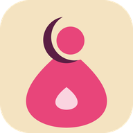
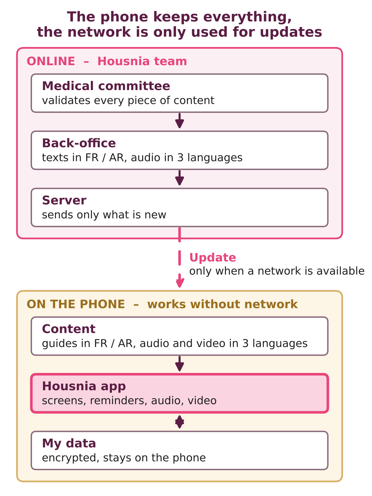

<p align="center"></p>

# Housnia

**Offline menstrual, pregnancy and postpartum health information for women and girls in Chad.**

Housnia is a free mobile app that helps women and girls understand their periods, follow their pregnancy, and recognise danger signs after childbirth. It is designed for low-literacy, low-connectivity settings: it works offline once installed, and every key message can be listened to, not only read.

> **Status: early prototype (October 2026).** This repository contains a first working prototype and the full design documentation. Health content in the prototype is a draft and must be validated by a Chadian medical committee before any public use.

## Try the prototype

- **Online (installs for offline use):** enable GitHub Pages for this repository, then open `https://<your-github-username>.github.io/housnia/app/` on an Android phone. After the first visit, add it to the home screen: it keeps working in airplane mode.
- **Locally:** open `app/index.html` in a browser.

## What the prototype does

| Feature | Description |
| --- | --- |
| Language choice | French, Arabic (right-to-left interface) and English for testing; audio and video in Chadian Arabic are planned |
| Profiles | Girl · I have my periods · I am pregnant · I recently gave birth |
| My Periods | Cycle calendar with predicted next period and fertile window |
| My Pregnancy | Week of pregnancy, expected due date, trimester advice, antenatal visit reminder |
| After Baby | Days since birth and key postpartum and newborn care messages |
| Learn | Short illustrated guides with a "Key point" box, a red "Go to the health centre if…" box, and a quiz |
| Emergency | Always-visible button with pregnancy and postpartum danger signs |
| Listen | Reads messages aloud with the phone's text-to-speech (recorded voices will replace it) |
| Privacy | No account, no name; all data stays on the phone (local storage) and can be erased in one tap |
| Offline | Service worker caches the whole app after the first visit |

## Planned production architecture

- **App:** Flutter, Android 6+ (1–2 GB RAM phones), iOS later.
- **Storage:** encrypted local database (SQLCipher); audio and video stored on the phone.
- **Content:** managed in an open-source headless CMS (Strapi or Directus), delivered as small, signed, versioned content packs that download only when a network is available, or are shared by Bluetooth / SD card.
- **Languages:** texts in French and Arabic; audio and video in French, Arabic and Chadian Arabic.
- **Impact data:** anonymous indicators (module completion, quiz scores before and after, reminders activated), sent only with consent and published on a public dashboard.



## Repository structure

```
app/            Working offline prototype (HTML / JavaScript progressive web app)
docs/           Project proposal, pitch deck and architecture diagram
LICENSE         MIT licence (software)
CONTENT-LICENSE CC BY 4.0 (health content and design)
```

## Roadmap (next 12 months)

1. Field research with women, girls and midwives in N'Djamena; set up a medical committee.
2. Write and validate the first 20 guides and 10 videos; record audio in French, Arabic and Chadian Arabic.
3. Build the Flutter app with content packs and privacy features.
4. Pilot with 300 women and girls in N'Djamena and one province; publish results.

## Team

**Housna Mahamat Ali** – Founder and project lead. Second-year midwifery student (Obstetric Care), Faculty of Human Health Sciences, University of N'Djamena, Chad.

Contact: housnia.tchad@gmail.com

## Licence

- Software: [MIT](LICENSE)
- Health content, texts and design: [CC BY 4.0](CONTENT-LICENSE)

Ministries, NGOs and other countries are welcome to reuse and translate Housnia.
